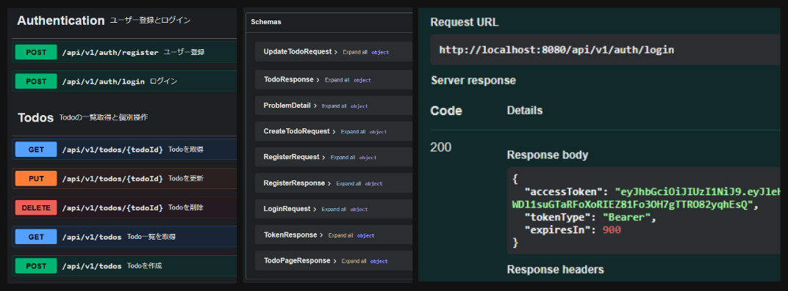
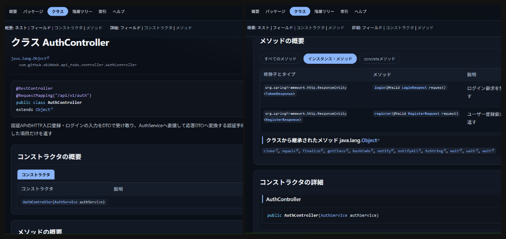

# テスト駆動開発による `OpenAPI` 実装




## 🎯 学習目標

**プロジェクトの目的**：実践を通して以下のスキルや知識を習得する

1. **テスト駆動開発**: 仕様検討→テストケース策定→RED→GREEN→Refactor[サイクルの徹底](#タスクの進め方)
2. **分離環境での単体・結合テスト（全110件）**: `Testcontainers`を用いてテスト実行ごとに使い捨て分離コンテナ環境の自動生成と検証
3. **レイヤードアーキテクチャ**: Controller/Service/Repository/Entity/DTOはじめ主要コンポーネントの責務と依存方向、主要アノテーションなど
4. **基本的なREST API設計**: リソースパス、HTTPメソッド・ステータス、エラー定義、ページネーションなど各種設計
5. **コードファーストOpenAPI**: アノテーション付与によるAPI仕様ドキュメントサイト`SwaggerUI`の自動生成方法
6. **データモデリングとJPA**: データ型、制約、JPA仕様のEntityマッピングなど
7. **JWT認証・認可**: 認証フロー、JWTとパスワード仕様、Todo所有者認可、認証未実装でも後続機能を実装するためのモックなど
8. **DevOps**: プッシュ時とPR作成時にテスト実行するCI、マージ時にJavadocをビルド・公開するCD、`Mise`による開発環境再現、`main`ブランチ保護ルールなど
9. **AI駆動開発**: エージェント制御仕様の随時改善、学習目的の対話的進行など

## 🛠 技術スタック

- **言語・ビルドツール**: `Java21`, `Gradle`
- **フレームワーク**: `Spring Framework(Boot)`
- **テスト**: `JUnit5`, `Mockito`, `Testcontainers`
- **DB**: `PostgreSQL` (開発用とテスト用), `Docker Compose`
- **ORM**: `SpringDataJPA` (`Hibernate`)
- **ドキュメント**: `SwaggerUI` (`springdoc-openapi`), `Javadoc`, `Github Pages`
- **認証**: `Spring Security` (`JWT`)
- **DevOps**: `Github Actions`, `Mise`
- **AIエージェント**: `OpenCode`, `Github Copilot`
- **その他**: Springモジュール（`Lombok`, `SpringBootDevTools`, `Validation`）

## 📚 Javadocドキュメント

ソース内のJavadocからクラスやメソッドの仕様文書を生成

### 🌐 公開サイト（GitHub Pages）

`main` ブランチへマージするたびに `.github/workflows/javadoc-pages.yaml` がJavadocをビルドしてGitHub Pagesへ自動デプロイします。

- **公開URL**: https://ok200ok.github.io/tdd-openapi-spring/

### 🖥 ローカル生成

```sh
./gradlew javadoc
open build/docs/javadoc/index.html
```

Windowsの場合は `.\gradlew.bat javadoc` 

## 🏗 アーキテクチャ図解

レイヤー構成、認証・認可フロー、データモデルをMermaidで図解しています。実装を読む前の全体像把握や、設計判断の理由の確認に利用してください。

- [アーキテクチャ図解（`docs/architecture.md`）](docs/architecture.md)

## 🗺 開発ロードマップ

### タスクの進め方

下記ロードマップ各Section内のチェックボックス1つを「タスク」とし、以下のワークフローを毎回適用する

1. **目的・仕様**: 範囲、仕様、選択肢と理由、受け入れ条件を合意する。
2. **テストケース**: 期待結果、対象レイヤー、検証境界・テスト種別などを合意し、[テストケース一覧](docs/test-case-catalog.md)を更新する
3. **テストコード追加**: まずテストコードだけを作成する。開発者が自らテストを実行するまで実装コードへ進まない。
4. **RED確認・最小実装**: REDの理由を確認後、最小限の本番コードを実装して設計理由などをJavadocコメントアウト解説として残す。
5. **GREEN確認・Refactor**: 開発者のテスト実行結果を確認後、必要な場合に限り振る舞いを保つRefactorを行う。
6. **ドキュメント更新・タスク完了**: 必要な検証・文書更新を行う。合意仕様やテストケース、期待結果、リンクなどを照合し、開発者と共に結果を確認してからタスクを完了扱いにする

### Section1: 環境構築とテスト基盤の準備
- [x] `Git` リポジトリ初期化・`.github/copilot-instructions.md` および `README.md` の作成
- [x] `build.gradle` の依存関係（`Spring Boot Starter`, `PostgreSQL`, `Testcontainers`, `Lombok` 等）の確認・追加
- [x] `Docker Desktop` の起動確認と `Testcontainers` の仕組み理解
- [x] `Testcontainers` を用いた `PostgreSQL` 接続確認テストの作成と実行（`GREEN` 確認）
- [x] Docker Composeによる開発用`PostgreSQL`と永続volumeの構成
- [x] 開発用DBの起動、アプリ接続、および停止後のデータ永続化確認
- [x] GitHub ActionsによるCIパイプラインの構築（作業ブランチへのpushと`main`向けPRでGradleテストおよびTestcontainersを実行し、GitHub上で成功・失敗を確認）
- [x] `main`ブランチの保護と必須CIチェックの設定

### Section2: データ層（`JPA` / `Repository`）の段階的な振り返り
- [x] `User` / `Todo` のユースケース、所有権、カラム・制約を含むデータモデルを確認・確定する（[`データモデル設計仕様`](docs/data-modeling.md)）
- [x] JPA EntityとSpring Data Repositoryの役割、および`@DataJpaTest`がPostgreSQL Testcontainersを使う仕組みを理解する
- [x] Userの基本マッピング（UUID、必須・任意カラム、長さ、作成・更新時刻）をRepositoryテストで確認する
- [x] `userName`の正規化・形式・一意性と検索をテストし、UserRepositoryの役割を確認する
- [x] Todoの基本マッピング（採番ID、タイトル・説明・状態、作成・更新時刻）をRepositoryテストで確認する
- [x] TodoとUserの必須リレーション、外部キー、遅延ロード、削除制約をテストし、所有者別データアクセスの土台を確認する
- [x] Section 2のRepositoryテストと既存テストを実行し、結果とデータモデル文書・チェック項目を照合する

### Section3: ドメイン・ビジネスロジック層（`Service`）の `TDD` 実装
- [x] `Mockito` を用いたモック化（`@Mock`, `@InjectMocks`）と単体テスト手法の理解
- [x] Todo作成のService単体テスト作成（`RED`）と実装（`GREEN`）
- [x] 所有者を指定したTodoのID検索のService単体テスト作成（`RED`）と実装（`GREEN`）
- [x] 所有者別Todo一覧のService単体テスト作成（`RED`）と実装（`GREEN`）
- [x] Todo更新のService単体テスト作成（`RED`）と実装（`GREEN`）
- [x] Todo削除のService単体テスト作成（`RED`）と実装（`GREEN`）

### Section4: API層（`Controller`）と `OpenAPI` の `TDD` 実装
- [x] Todo API契約の設計（URL、メソッド、入出力、ステータス、エラーの合意）
- [x] UTC基準の日時型への見直し（Entityの日時型をInstant、PostgreSQL列をtimestamptzとする設計・実装。Repositoryテストで永続化と時点を確認）
- [x] Todo一覧のDBページネーション（RepositoryでDBページ分割し、Serviceが所有者条件とページ指定を委譲。公開APIは1始まり、既定サイズ5、最大100。Repository実DBテストとService単体テストで確認）
- [x] DTO・Validationの詳細設計（Java record DTO、入力制約、Problem Detailsの入力エラー拡張を合意し、[DTO仕様](docs/dto-validation.md)と[テストケース一覧](docs/test-case-catalog.md)へ記録）
- [x] TodoControllerのTDD（`@WebMvcTest`／`MockMvc`でHTTP境界、Validation、応答とService連携をテストし、RED・GREENを確認。仕様は[DTO仕様](docs/dto-validation.md)、合意ケースは[テストケース一覧](docs/test-case-catalog.md)を参照）
- [x] ローカル所有者境界と初期データ（ローカル専用ユーザー・Todo約15件を用意し、認証前の所有者ID解決からServiceへの受け渡しを確認）
- [x] OpenAPI／Swagger UI（`springdoc-openapi`で`/v3/api-docs`のAPI仕様を生成し、`/swagger-ui.html`でエンドポイントとスキーマを確認）

### Section5: 認証・認可基盤の追加
- [x] [`認証・認可設計仕様`](docs/authentication-design.md)と[`API設計仕様`](docs/api-design.md)を参照し、`Spring Security`の標準機能を使う認証方式とAPI契約（登録・ログイン、パスワードハッシュ、JWT、認可境界、エラー応答）を合意する
- [x] ユーザー登録とパスワードハッシュ化を担う`UserService`の単体テスト作成（`RED`）と実装（`GREEN`）
- [x] `JWT` 発行・検証ユーティリティ（`JwtTokenProvider` 等）の単体テスト作成（`RED`）と実装（`GREEN`）
- [x] ステートレスな`Spring Security`設定とBearer認証を実装し、認証済みユーザーのIDをTodo APIへ渡す（MVCテストで確認）
- [x] 本番用`JwtEncoder`／`JwtDecoder` Beanと署名鍵設定を追加して`@SpringBootTest`とCIを成功させ、既存Controllerテストを共通テスト設定の実Bearer tokenによる認証前提へ移行する
- [x] 登録・ログインAPIを実装してJWTを発行し、認証・認可の応答とOpenAPI仕様を検証する
- [x] 認証前のローカル所有者Resolver・サンプル初期化機能と専用テスト、`application-local.yaml`を撤去する。併せて不要になった`OwnerIdResolver`抽象を削除し、Controllerが認証主体（`@AuthenticationPrincipal Jwt`）を直接扱うよう整理する

### Section6: 認証接続後の結合テストと総仕上げ
- [x] `@SpringBootTest` + `Testcontainers` による認証からTodo操作までの一連の処理を検証する
- [x] `./gradlew test` による全テストスイートの一括実行確認
- [x] ドキュメント再構成・整理
- [x] JavadocをGitHub ActionsでビルドしGitHub Pagesへ自動デプロイする（公開URLは https://ok200ok.github.io/tdd-openapi-spring/ ）

## 🚀 起動方法

### ☕ MiseによるJava環境の準備

本リポジトリと完全に同一のJava環境を再現する場合、以下手順を実行してください。

1. [mise公式ドキュメント](https://mise.jdx.dev/getting-started.html)に従ってmise CLIをインストールします
2. リポジトリをクローンし、プロジェクトのルートディレクトリへ移動します
3. `mise.toml` の内容を確認してから、下記コマンドで特定バージョンの言語やツールをインストールします
  ```sh
  mise install
  ```
4. その後、[シェルでmiseを有効化](https://mise.jdx.dev/getting-started.html#activate-mise)します。

### 🐋 開発用DB

開発時のPostgreSQLはDocker Composeで起動し、名前付きvolumeにデータを保持します。アプリケーション自体はローカルで実行します。テスト時は開発用DBを共有せず、Testcontainersが独立したPostgreSQLコンテナを起動します。

ローカル開発専用の接続情報は `compose.yaml` と `application.yaml` に定義しています。**本番環境の認証情報として使用しないでください**

```
docker compose up -d --wait
docker compose ps
```

コンテナ終了は

```
docker compose down
```

`down` はコンテナを停止・削除しますが、DBデータはvolumeに残ります。データも削除する場合に限り `docker compose down -v` を実行してください。

### 🐘 開発用Springサーバー

miseをシェルで有効化済みなら、`mise exec --`を省略できるので、

↓macOS / Linuxなら
```sh
./gradlew bootRun
```

↓Windowsなら
```powershell
.\gradlew.bat bootRun
```

いずれもGradle Wrapperがプロジェクト指定のGradleを使用します。
