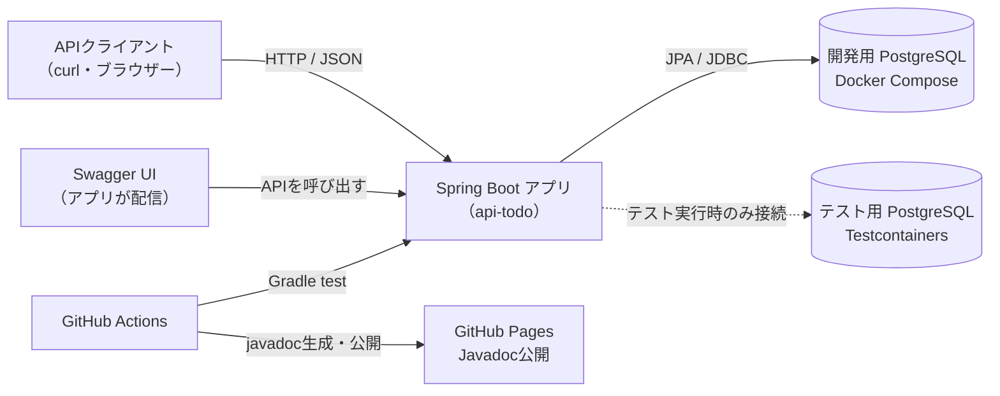
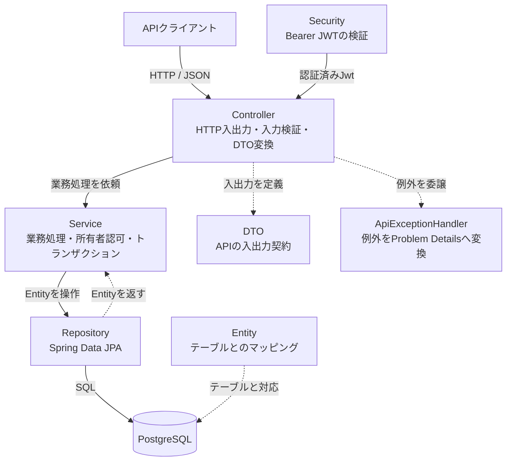
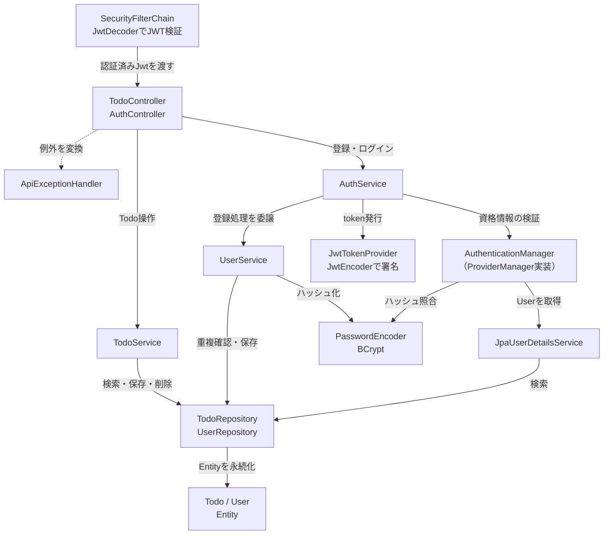
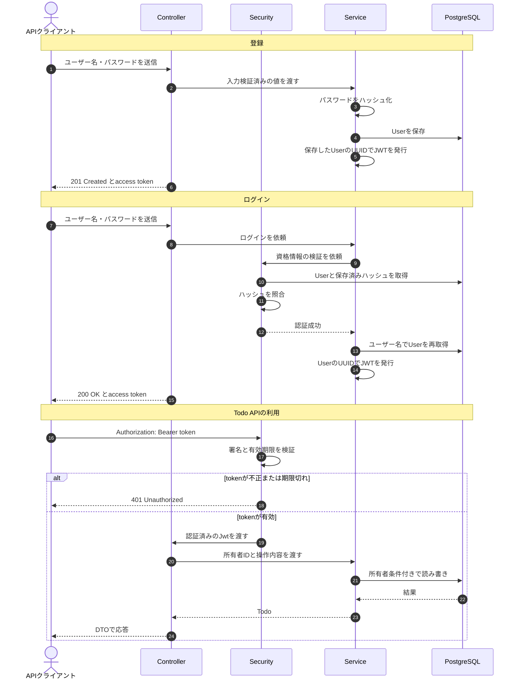
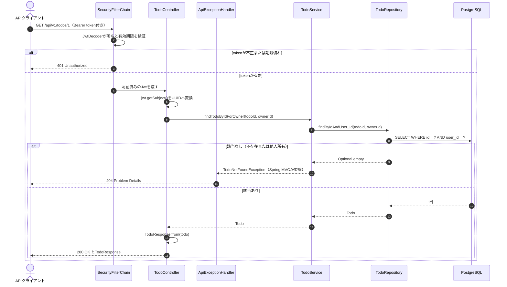
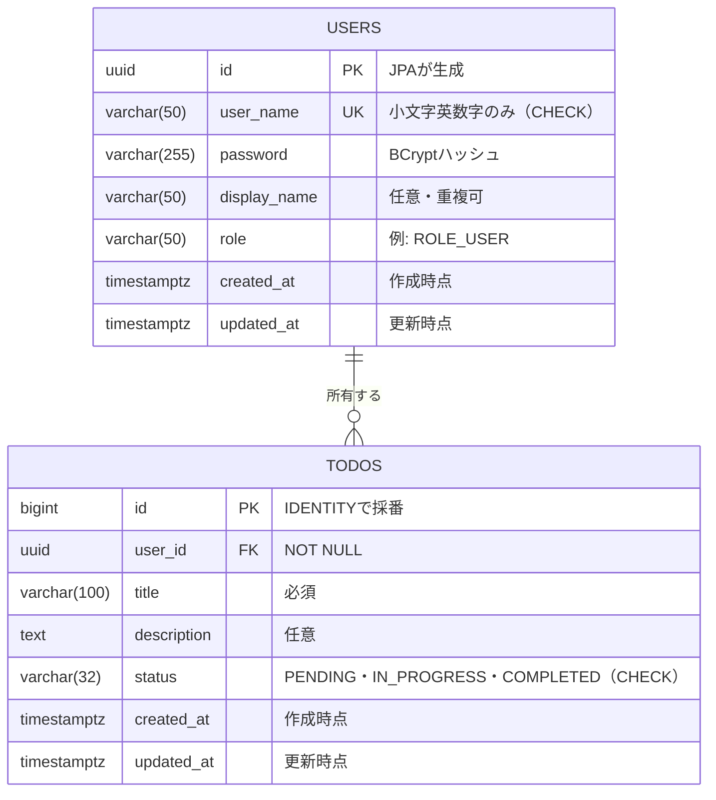

# アーキテクチャ図解

Spring Boot製Todo APIの全体像、レイヤー構成、認証・認可フロー、データモデルをMermaidで図解する。実装を読む前の全体像把握と、設計判断の理由を理解することを目的とする。

- 対象読者: 新規参加者（Java・Springの学習者を含む）
- 前提: `Java 21`、`Spring Boot 4.1.1`、認証ありの構成
- 読み方: 初学者は図1→図2→図4の順に読み、図3と図5で実装の詳細を確認する
- 図の正: 既存の[API設計仕様](api-design.md)、[認証・認可設計仕様](authentication-design.md)、[データモデル設計仕様](data-modeling.md)、[DTO・Validation設計仕様](dto-validation.md)、実装コード。本ドキュメントはそれらの可視化であり、独自の仕様は定義しない

## 図の一覧

| 図 | 種別 | 内容 |
| --- | --- | --- |
| 図1 | 概念 | システム全体像と実行環境 |
| 図2 | 概念 | レイヤー構成と依存方向 |
| 図3 | 実装 | 主要クラス・Beanの構成 |
| 図4 | 概念 | 認証・認可フロー |
| 図5 | 実装 | Todo API利用時の認証・認可の実装フロー |
| 図6 | 実装 | ER図（`users` / `todos`） |

## 図1: システム全体像

目的: アプリケーションの外側にある利用者・実行環境・開発環境の関係を把握する。

この図で答えられる問い:

- 開発時とテスト時で、どのPostgreSQLに接続するか
- Swagger UIとJavadocは、それぞれ何が生成・配信しているか

### 用語と補足

- **Spring Boot**: アプリケーションの起動、Webサーバー、DIコンテナ、設定をまとめて提供するフレームワーク。`ApiTodoApplication`の`main`メソッドが起点になる
- **Docker Compose**: 開発用PostgreSQLをローカルで起動する仕組み。データは名前付きvolumeに残り、`docker compose down`では消えない
- **Testcontainers**: テスト実行時に使い捨てのPostgreSQLコンテナを起動するライブラリ。開発用DBを共有しないため、テスト同士や開発データの影響を受けない
- **Swagger UI**: `springdoc-openapi`がControllerとDTOから生成したOpenAPI仕様を表示する画面。アプリ自身が配信する
- **Javadoc**: ソースのコメントから生成するAPI文書。GitHub Actionsが`main`ブランチへのマージ時または手動実行時に生成し、GitHub Pagesへ公開する

アプリは起動時に`application.yaml`の`DB_URL`などで接続先を決める。テスト時は`TestcontainersConfiguration`の`@ServiceConnection`が接続情報を差し替えるため、テストコードに接続設定を書かない。

## 図2: レイヤー構成（概念）

目的: リクエストがどの層をどの順に通り、各層が何を担当するかを把握する。

この図で答えられる問い:

- 入力検証、業務処理、SQL発行は、それぞれどの層の責務か
- なぜControllerがEntityを直接返さないのか

### 用語と補足

- **レイヤー**: 変更理由と責務ごとにコードを分けたまとまり。本プロジェクトは`controller`、`service`、`repository`、`entity`、`dto`の5つを基本とする
- **依存方向**: 呼び出しは上から下へ一方通行にする。ControllerがRepositoryを直接呼ぶ、EntityがServiceを参照する、といった逆流や飛び越しを作らない
- **DTO（Data Transfer Object）**: APIの入出力専用のデータ型。`CreateTodoRequest`や`TodoResponse`が該当し、Javaの`record`で定義する
- **Entity**: テーブル1つに対応するJPAのクラス。`User`と`Todo`が該当する
- **トランザクション**: 複数のDB操作をひとまとまりとして扱う単位。`TodoService`の更新・削除では`@Transactional`により、検索と変更の間に他の処理が割り込まない
- **Problem Details**: RFC 9457で定義されたHTTPエラー本文の形式。`application/problem+json`で返す

ControllerはDTOで受け取った入力を業務処理に必要な値へ分解してServiceへ渡し、ServiceとRepositoryの間ではEntityを扱う。API応答はDTOへ変換するため、ControllerがEntityをそのまま返すことはない。理由は「設計判断」の2番で説明する。

## 図3: 主要クラス・Beanの構成（実装）

目的: 図2の層を、実際のクラス名とBeanの依存関係で確認する。

この図で答えられる問い:

- あるクラスが、どのクラスに依存しているか
- 認証に関わるクラスが、Todo APIの処理とどこで接続するか

### 用語と補足

- **Bean**: SpringのDIコンテナが生成・管理するオブジェクト。`@Service`、`@Component`、`@Configuration`の`@Bean`メソッドなどで登録する
- **DI（依存性注入）**: クラスが自分で依存先を`new`せず、コンストラクター経由で受け取る仕組み。テストでモックへ差し替えやすくなる
- **SecurityFilterChain**: Spring Securityのフィルター群の構成。`SecurityConfiguration`がBeanとして定義し、Todo APIだけを認証必須にしている
- **AuthenticationManager**: ログイン時の資格情報検証の入口。`DaoAuthenticationProvider`が`JpaUserDetailsService`と`PasswordEncoder`を使って照合する
- **JpaUserDetailsService**: DBの`User`をSpring Securityの`UserDetails`へ変換する。パスワードはハッシュのまま渡し、照合は`PasswordEncoder`に任せる
- **JwtEncoder / JwtDecoder**: JWTの署名と検証を担うSpring Securityの標準部品。`JwtConfiguration`が`app.security.jwt.secret`から生成し、発行時は`JwtTokenProvider`が`JwtEncoder`を、Todo APIの検証時はResource Serverが`JwtDecoder`を使う
- **JwtTokenProvider**: `sub`にUserのUUIDを入れ、15分有効のHS256署名JWTを発行する

補足: `AuthenticationManager`として`ProviderManager`をBean登録し、現在はDB認証のProviderだけを登録している。`PasswordEncoder`は`UserService`の登録処理と`AuthenticationManager`の照合処理の両方から使われる。

## 図4: 認証・認可フロー（概念）

目的: 登録・ログイン・Todo API利用の3つの流れで、誰が何を検証し、何を根拠に所有者を決めるかを把握する。

この図で答えられる問い:

- パスワードはどの時点でハッシュ化され、どこで照合されるか
- Todoの所有者は、リクエストのどの情報から決まるか

### 用語と補足

- **認証**: 利用者が本人かどうかを確かめること。ログインとJWT検証が該当する
- **認可**: 認証済みの利用者が、その操作を行ってよいかを決めること。Todoの所有者判定が該当する
- **JWT（JSON Web Token）**: 署名付きの文字列。`sub`（subject）にUserのUUIDを入れ、`exp`に有効期限を入れる
- **Bearer token**: `Authorization: Bearer <token>`の形式で送るtoken。Cookieと違い、ブラウザーが自動送信しない
- **ハッシュ化**: パスワードから一方向の変換を行い、元の文字列へ戻せない形で保存すること。照合時は同じ変換結果を比較する
- **401 Unauthorized**: 認証情報がない、不正、期限切れを表す。**403 Forbidden**は認証済みだが権限が足りない場合に使う
- **404 Not Found**: 本プロジェクトでは「Todoが存在しない」と「他ユーザーが所有している」を区別せず、同じ404にする。存在の有無を推測させないため

所有者はJWTの`sub`だけから決め、リクエスト本文やクエリのユーザーIDは受け取らない。クライアントが送ったIDを信用すると、他人のTodoを指定できてしまうため。

## 図5: Todo API利用時の実装フロー

目的: 図4のうちTodo API利用の流れを、実際のクラスとメソッドで追う。

この図で答えられる問い:

- Bearer tokenはどのクラスで検証され、Controllerへどう渡るか
- 他人のTodoを指定した場合、どの時点で404へ変換されるか

### 用語と補足

- **`@AuthenticationPrincipal Jwt`**: 認証済みのJWTをControllerの引数として受け取るアノテーション。Controllerが自分でヘッダーを解析しない
- **`jwt.getSubject()`**: JWTの`sub`を取り出す。ここにはUserのUUID文字列が入っている
- **派生クエリ**: `findByIdAndUser_Id`のように、メソッド名からSpring Data JPAが検索条件を組み立てる仕組み。`User_Id`は`user`関連の`id`をたどる意味
- **`Optional.empty()`**: 検索結果がないことを表す。Todo不存在と所有者不一致の両方を同じ空として扱う
- **`TodoNotFoundException`**: Serviceが投げる独自例外。`ApiExceptionHandler`が404のProblem Detailsへ変換する
- **`TodoResponse.from(todo)`**: Entityを応答DTOへ変換する。所有者IDなどAPI契約にない項目はここで落とす

登録・ログインの実装上の呼び出し順は、図4に次の対応を当てはめると読み取れる。

| 概念（図4） | 実装（図3のクラス） |
| --- | --- |
| パスワードのハッシュ化と保存 | `AuthService.register` → `UserService.registerUser` → `PasswordEncoder.encode` → `UserRepository.save` |
| 資格情報の検証 | `AuthService.login` → `AuthenticationManager.authenticate` → `JpaUserDetailsService.loadUserByUsername` → `PasswordEncoder.matches` |
| ユーザーの再取得 | `AuthService.login` → `UserRepository.findByUserName` |
| JWTの発行 | `AuthService` → `JwtTokenProvider.createToken` → `JwtEncoder.encode` |

ログインでは認証成功後にユーザー名でUserを再取得し、UUIDをtokenの`sub`に使う。認証結果にはUUIDが含まれず、`Authentication.getName()`はユーザー名を返すため。

## 図6: ER図（実装）

目的: 永続化する2つのテーブルと、その関係・制約を把握する。

この図で答えられる問い:

- TodoはどのようにUserへ紐づくか
- どの列が必須で、どの制約がDB側で守られているか

### 用語と補足

- **PK / FK / UK**: 主キー、外部キー、一意キー。`TODOS.user_id`は`USERS.id`を参照する外部キーで、非NULL
- **CHECK制約**: 列に入れてよい値をDB側で限定する制約。`user_name`の形式と`status`の値が対象
- **索引**: 検索を速くするためのDB構造。`todos(user_id)`に`idx_todos_user_id`を作り、所有者別の検索に使う
- **`timestamptz`**: PostgreSQLの`TIMESTAMP WITH TIME ZONE`。時点を保存する型として使い、`Instant`と対応付ける
- **`IDENTITY`**: INSERT時にDBが連番を採番する方式。`Todo.id`が該当する
- **削除カスケードなし**: Userを削除してもTodoは消さず、参照中のUserの削除は外部キー制約で拒否する。User削除機能は現スコープにない

ER図は列と関係を表し、索引名・制約名・DDLの詳細までは表せない。正確な定義は[データモデル設計仕様](data-modeling.md)を参照する。

## 設計判断

ここでは、構成を決めた理由と、採らなかった代替案を整理する。

### 1. レイヤードアーキテクチャを採用する

- 判断: `controller`、`service`、`repository`、`entity`、`dto`に分割し、依存を上から下へ向ける
- 理由: 変更理由が層ごとに分かれ、テストも層に応じて使い分けられる。HTTP境界は`@WebMvcTest`、業務処理はMockito、DB操作は`@DataJpaTest`、全体は`@SpringBootTest`で検証する
- 代替案: ControllerにHTTP処理・業務処理・SQLをまとめる。小規模なら動くが、入力検証と業務ルールとクエリが混ざり、テストが結合テスト中心になる
- 制約: 層をまたぐ変更では複数クラスを直す必要がある。依存の逆流を作らない規律が要る

### 2. EntityをAPIへ公開せずDTOへ変換する

- 判断: Controllerの境界でEntityをDTOへ変換し、リクエストもDTOで受ける
- 理由: EntityはDB構造に密着しており、列の追加・改名がそのままAPIの破壊的変更になる。遅延ロードによる意図しないSQLや、所有者IDなど不要な情報の露出も防げる
- 代替案: Entityをそのまま返す。実装は短くなるが、API契約がDBに固定され、JPAの状態（遅延ロード・永続化コンテキスト）が外部へ漏れる
- 制約: 変換コードが必要になり、項目追加時にDTOと変換の両方を更新する

### 3. DTOを`record`で定義する

- 判断: `CreateTodoRequest`や`TodoResponse`などをJava 21の`record`にする
- 理由: 値が不変になり、getter・equals・toStringなどの定型コードが不要になる。APIの契約がコンストラクター引数として一覧できる
- 代替案: 通常のクラス＋Lombok。可変にできてしまうため、処理の途中で値が変わる余地が残る
- 制約: 継承できないため、似た契約は別のrecordとして定義する。部分更新には向かない

### 4. 認可をService/API層で行い、Entityに持たせない

- 判断: 所有者条件をRepositoryの検索条件へ含め、Serviceが`TodoNotFoundException`で失敗させる
- 理由: 「誰が操作してよいか」はユースケースごとの判断であり、テーブル構造を表すEntityの責務ではない。検索条件に所有者を含めるため、取得した後に判定を忘れる余地もない
- 代替案: Entityに`isOwnedBy`のようなメソッドを置き、呼び出し側で判定する。判定の呼び忘れがそのまま情報漏洩になる
- 制約: Serviceの各メソッドが所有者IDを受け取り、Repositoryへ渡す必要がある

### 5. 所有者をJWTの`sub`から決め、他人所有は404にする

- 判断: リクエストにユーザーIDを含めず、`sub`のUUIDを所有者とする。不存在と他人所有は同じ404にする
- 理由: クライアントが送るIDは改ざんできる。`sub`は発行時にサーバーが決めるため信用できる。404に統一すると、他人のTodoが存在するかどうかを推測できない
- 代替案: リクエスト本文やクエリでユーザーIDを受け取る（改ざん可能）。他人所有に403を返す（存在が分かってしまう）
- 制約: ユーザーのUUIDを変更しない前提になる。変更する場合は再ログインが必要

### 6. JWT検証をResource Serverの標準機能へ任せる

- 判断: `oauth2ResourceServer().jwt()`を使い、独自のJWT検証フィルターを書かない
- 理由: Bearer tokenの抽出、署名・有効期限の検証、401応答といった定型的で間違えやすい処理をフレームワークへ任せられる
- 代替案: `OncePerRequestFilter`で自前検証する。学習にはなるが、検証漏れや例外処理の不備が脆弱性へ直結する
- 制約: 401の本文形式は標準実装に依存するため、API契約では本文を規定していない

### 7. Todoの初期状態をDB DEFAULTでなくServiceで設定する

- 判断: 作成時に`TodoService`が`TodoStatusEnum.PENDING`を設定する
- 理由: 初期状態は業務ルールであり、Serviceを読めば分かる形にしたい。DB DEFAULTにすると、API以外の経路で保存した場合にも同じ値が入り、ルールの所在が見えにくくなる
- 代替案: `status`列に`DEFAULT 'PENDING'`を付ける。DDLは簡単になるが、なぜその値なのかがアプリケーションコードから読み取れない
- 制約: Todoの作成は必ずServiceを経由する必要がある。DBのNOT NULL制約は、設定漏れを最後に防ぐ役割になる

### 8. テストはTestcontainersで分離する

- 判断: Repositoryテストと結合テストで、TestcontainersのPostgreSQL 17コンテナを使う
- 理由: 開発用DBのデータに依存せず、毎回同じ初期状態で検証できる。PostgreSQL固有の型・制約・SQLをそのまま確認できる
- 代替案: H2などのインメモリDBを使う。起動は速いが、方言や制約の違いにより本番DBの検証にならない。開発用DBの共有は、データ汚染や実行順序への依存を生む
- 制約: Dockerの起動が必要で、テスト開始にコンテナ起動の時間がかかる

## 対象外

- 本番運用（スケーリング、監視、鍵ローテーション、レート制限）
- 全クラス・全メソッドの網羅的な一覧
- 個別のテストケースの詳細（[テストケース一覧](test-case-catalog.md)を参照）
- DBマイグレーションの運用（現在はローカル学習用に`ddl-auto: update`を使用）
- フロントエンドの実装

## 更新ルール

- 図の正は既存の仕様書と実装とする。図だけを先に変更して仕様を変えない
- 次の変更を含む場合は、同じ変更の中で本ドキュメントの図も更新する
  - エンドポイントの追加・変更・削除
  - 層や主要クラスの追加・改名・依存関係の変更
  - テーブル・列・制約・関係の変更
  - 認証・認可方式やJWTのclaimの変更
- 図を更新したら、GitHubのプレビューで描画を確認する。Mermaidの構文エラーはコードブロックとして表示され、図にならない
- 図中のクラス名・エンドポイントが実装と一致しているか確認する

## 参照ドキュメント

- [API設計仕様](api-design.md): パス、HTTPメソッド、ステータス、エラー形式
- [認証・認可設計仕様](authentication-design.md): JWT、認可境界、失敗時の判断
- [データモデル設計仕様](data-modeling.md): テーブル定義、制約、Entityマッピング
- [DTO・Validation設計仕様](dto-validation.md): 入力項目と検証制約
- [テストケース一覧](test-case-catalog.md): テストの期待結果と実行状態
